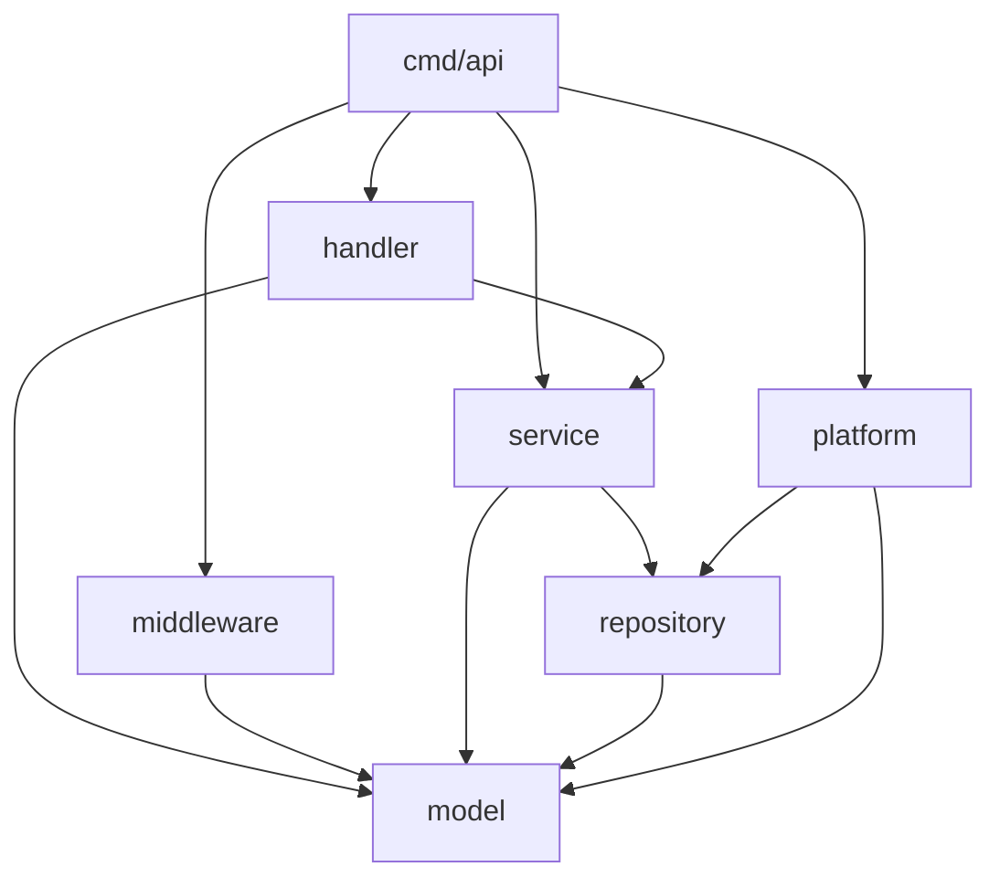

# AI B2B SaaS Template

Module path: `github.com/wasinuddy/ai-b2b-saas-template`.

A Go API skeleton for Fiber v2 (`github.com/gofiber/fiber/v2`) with a layered architecture and SQLite. GORM talks to the database. Schema changes are SQL files in `migrations/`, applied by hand. `gorm.AutoMigrate` is not used.

golangci-lint enforces layer boundaries with depguard and maintainability limits on function size, complexity, parameters, shadowing, and error handling. API shape is enforced by a generated OpenAPI spec, a Spectral ruleset, a small Go analyzer, and contract tests. `make check` runs all of them.

## Layout

```text
.
├── cmd/api/main.go                 # composition root: wiring and process lifecycle
├── configs/app.env.example         # documented environment variables
├── internal/
│   ├── handler/                    # Fiber routes and request/response mapping
│   ├── middleware/                 # Fiber middleware
│   ├── model/                      # domain types, no HTTP or database details
│   ├── repository/                 # data-access interfaces
│   ├── service/                    # use cases and business rules
│   └── platform/
│       ├── config/                 # environment configuration
│       ├── database/               # open and close SQLite
│       └── gormrepo/               # GORM implementations of repository interfaces
├── migrations/                     # numbered SQLite SQL files
├── Dockerfile                      # builds the frontend, then the API image that serves it
├── webui/                          # Vite + React + TypeScript + Tailwind CSS frontend (see webui/README.md)
├── api/swagger.yaml                # generated OpenAPI 2 spec
├── docs/api-design.md              # HTTP conventions and the check for each one
├── .spectral.yaml                  # Spectral rules for paths, status codes, and JSON
├── .golangci.yml
├── .testcoverage.yml               # 85% statement coverage gate for internal/service
├── Makefile
└── go.mod
```

Each internal package has a `doc.go` that restates what that package may import.

## Dependency direction

`cmd/api` is the only place that knows every layer. It constructs the GORM repository, passes it to the service as a `repository` interface, and passes the service to the handler.



| Package | May import | Must not import |
| --- | --- | --- |
| `model` | standard library | any other `internal` package, Fiber, GORM |
| `repository` | `model`, standard library | `service`, `handler`, `middleware`, `platform` |
| `service` | `repository`, `model` | `handler`, `middleware`, `platform`, Fiber, GORM |
| `handler` | `service`, `model`, `middleware`, Fiber | `repository`, `platform`, GORM |
| `middleware` | `model`, Fiber | `handler`, `repository`, `platform`, GORM |
| `platform` | `repository`, `model`, GORM, the SQLite driver | `handler`, `middleware`, `service` |
| `cmd/api` | every layer above | GORM and the SQLite driver directly |

Fiber is limited to `internal/handler`, `internal/middleware`, and `cmd`. GORM, `github.com/glebarez`, `modernc.org/sqlite`, and `database/sql` are limited to `internal/platform`.

depguard is the architecture guard rail. A violation names the rule and how to fix it.

## Maintainability guard rails

| Concern | Linter | Limit | How to fix |
| --- | --- | --- | --- |
| Long functions | `funlen` | 60 lines, 40 statements (`_test.go` exempt) | Extract helpers; keep handlers thin |
| Cyclomatic complexity | `gocyclo` | 15 | Split branches into smaller functions |
| Cognitive complexity | `gocognit` | 15 | Flatten logic with early returns |
| Nested `if` depth | `nestif` | 4 | Use guard clauses instead of nesting |
| Too many parameters | `revive` (`argument-limit`) | 5 | Introduce an options or input struct |
| Too many return values | `revive` (`function-result-limit`) | 3 | Return a struct or small result type |
| Unused code | `unused`, `unparam`, `ineffassign`, `wastedassign` | — | Remove dead code and unread assignments |
| Shadowed variables | `govet` (`shadow`, strict), `revive` (`import-shadowing`) | — | Rename inner variables (`closeErr`, not `err`) |
| Unchecked errors | `errcheck` | assertions and `_ = err` | Handle or wrap every error |
| Nil in error branch | `nilerr` | — | Return a real error, not `nil` |
| `nil, nil` returns | `nilnil` | — | Return a sentinel error from repositories |
| Error naming | `errname` | `ErrX`, `XError` | Rename sentinels and error types consistently |

A `//nolint` comment must name the specific linter and include an explanation; a bare `//nolint` does not silence the check.

## Run

Requires Go 1.26, Node 24, and pnpm 11.

For fullstack local development (Go API on `:8080` + Vite dev server on `:5173` proxying `/api`, with `air` hot-reload if installed):

```bash
make dev
```

Or run only the Go API:

```bash
go run ./cmd/api
```

With no environment variables, the process listens on `:8080`, creates `app.db` in the working directory, and automatically runs pending embedded SQL migrations (`DB_AUTO_MIGRATE=true`). Foreign keys, WAL, and a 5 second busy timeout are set through the default DSN.

```bash
curl -s localhost:8080/healthz
curl -s localhost:8080/readyz
```

`GET /healthz` only checks that the process is up. `GET /readyz` checks that SQLite accepts a connection. Unmatched routes return the shared error shape, for example `{"error":{"code":"NOT_FOUND","message":"not found"}}`.

Stop the process with Ctrl+C. It finishes in-flight requests, then closes the database.

`configs/app.env.example` documents `HTTP_ADDR`, `DB_DSN`, `DB_AUTO_MIGRATE`, `WEBUI_DIR`, and `AUTH_ENABLED`. The process does not load that file. To use it:

```bash
set -a
source configs/app.env.example
set +a
go run ./cmd/api
```

An empty `HTTP_ADDR` or `DB_DSN` is rejected. Unset variables fall back to the defaults in `internal/platform/config`.

## Migrations

Add a numbered SQLite file such as `migrations/0001_create_items.sql`. `migrations/embed.go` embeds every `*.sql` file into the Go binaries.

- By default (`DB_AUTO_MIGRATE=true`), `cmd/api` applies pending migrations transactionally on startup (tracked in `schema_migrations`).
- To run migrations manually or in a separate init container, run `make migrate` (or `docker run --entrypoint /app/migrate -v ai-b2b-saas-data:/data ai-b2b-saas`).

## Optional authentication middleware

The template includes a generic bearer-token auth middleware (`middleware.RequireAuth` and `middleware.AuthClaims` in `internal/middleware/auth.go`) without imposing a user/password schema. It is **disabled by default** (`AUTH_ENABLED=false`):

- When `AUTH_ENABLED=false`, `middleware.RequireAuth` passes requests through unchanged.
- When you need auth, implement `middleware.TokenVerifier` with your chosen strategy (username/password, JWT, sessions, OAuth/OIDC, or API keys), wire it in `cmd/api/main.go`, mount protected groups with `deps.AuthGuard` in `internal/handler/router.go`, and set `AUTH_ENABLED=true`. Missing or invalid bearer tokens automatically return the shared `401 UNAUTHENTICATED` `ErrorResponse`.

## Add a feature

Follow the health check as the shape of a new use case:

1. Add domain types in `internal/model`.
2. Add a repository interface in `internal/repository`.
3. Add the SQL migration and implement the interface in `internal/platform/gormrepo`. Include `var _ repository.SomeRepository = (*SomeRepository)(nil)`.
4. Add the use case in `internal/service`, depending only on the interface. Cover the business rule with a unit test and a fake repository so the service package stays at or above the 85% coverage gate.
5. Add the Fiber handler, request and response DTOs, swag annotations, and route in `internal/handler`. Follow [docs/api-design.md](docs/api-design.md).
6. Run `make generate` and commit `api/swagger.yaml`. Add a contract-test case for the status codes and payloads.
7. Wire the implementation in `cmd/api/main.go`.
8. Run `make check`.

## API conventions

[docs/api-design.md](docs/api-design.md) is the source of truth for paths, methods, status codes, JSON, errors, and pagination.

- Public paths start with `/api` and are versioned nouns: `/api/v1/bookings/{bookingId}`. `/healthz` and `/readyz` stay at the root without `/api`.
- JSON and parameters are camelCase. Success returns the resource. Errors use `{"error":{"code","message","details"}}`.
- Handlers bind request DTOs and respond with response DTOs. Domain types in `internal/model` have no JSON tags.

## Backend checks and what they prevent

Every check runs in `make check`, in CI, and when an agent stops. Each row names the mistake an AI agent tends to make and the check that blocks it.

| Check | Prevents |
| --- | --- |
| `depguard` layer rules | Fiber or GORM leaking into the wrong layer, handlers calling repositories, services importing platform code. The result is tangled code that can't be tested without a database. |
| `forbidigo` | `fiber.Map`, `c.JSON`, `c.BodyParser`, `c.QueryParser`, and `fmt.Print`. Responses and bodies stay on the shared `respond`, `bindJSON` and `bindQuery` helpers, so validation and error shape are never skipped. |
| `apilint` `dto-only-requests` and `dto-only-responses` | Binding a request to a domain or database model, or returning one. Internal fields and IDs don't leak into the API. |
| `apilint` `model-no-wire-tags` | `json` tags on domain types, which ties the domain to the wire format. |
| `apilint` `dto-explicit-fields` | DTO fields with no `json` or `query` tag, no `required` or `omitempty`, or `omitempty` set in only one of the `json` and `validate` tags. The spec would say a field is required while the validator accepts it missing. |
| `apilint` `handler-annotated` | A handler with no swag `@Router`, `@Success` or `@Failure ErrorResponse`, so the endpoint never reaches the spec. |
| `api-check` | `api/swagger.yaml` drifting from the swag comments, or comments left unformatted. |
| Spectral ruleset | Paths, methods, status codes, pagination and JSON naming that break [docs/api-design.md](docs/api-design.md). Examples are verbs in paths, non-camelCase fields, a missing 404 or 400, and an unpaginated list. |
| `api-lint-selftest` | A Spectral rule that silently stops firing, or starts flagging a valid API. Each rule must fire on `api/testdata/bad.yaml` and `api/testdata/good.yaml` must lint clean. |
| Contract tests (`internal/handler/contract_test.go`) | Routes missing from the spec, spec operations with no route, and responses whose status or body differ from the spec. |
| Error handler tests | Stack traces, SQL errors or secrets in a response, and panics that return anything but the shared 500. |
| `gosec`, `errcheck`, `errorlint`, `nilerr`, `nilnil` | Insecure code, ignored or mis-wrapped errors, and `nil, nil` returns that hide failures. |
| `funlen`, `gocognit`, `gocyclo`, `nestif`, `revive` limits | Long, deeply nested or many-argument functions. Agents tend to produce these when they pile logic into one place. |
| `govet` (`shadow`, `nilness`, `unusedwrite`), `unused`, `unparam`, `wastedassign` | Shadowed variables, dead code and useless assignments. |
| `tagliatelle`, `musttag`, `errchkjson` | Wrong tag casing, structs encoded without tags, and unchecked JSON errors. |
| `sloglint`, `nolintlint` | Inconsistent logging, and `//nolint` comments that don't name a linter or give a reason. |
| `go-test-coverage` | Business logic in `internal/service` falling below 85% coverage. |
| Hooks self-test | The agent stop hook breaking, or the retry cap that stops an endless fix loop. |
| Stop-hook fingerprint | A stale pass. Editing the Makefile, scripts, tools, or lint and spec config forces a fresh run. |

Do not weaken a check to make a change pass. Fix the code, or add a `//nolint:<linter> // reason` or a Spectral override with a comment that says why.

## Lint and test

```bash
make check
```

That runs, in order:

| Target | What it checks |
| --- | --- |
| `api-check` | swag comments are formatted and `api/swagger.yaml`, `api/openapi.yaml`, and `webui/src/types/api.gen.ts` match `make generate` |
| `api-lint` | Spectral rules in `.spectral.yaml` |
| `api-lint-selftest` | every custom Spectral rule fires on `api/testdata/bad.yaml` and `api/testdata/good.yaml` lints clean |
| `lint` | golangci-lint, including depguard, tagliatelle, musttag, forbidigo, and errchkjson |
| `apilint` | handler DTOs, swag annotations, error causes, and domain JSON tags |
| `test` | unit tests, OpenAPI contract tests, and the `internal/service` coverage gate |
| `webui-check` | frontend TypeScript typecheck, ESLint (layer + OpenAPI-client rules), Prettier, Vitest, and Vite build |
| `hooks-selftest` | Cursor, Claude Code, and Codex hook output (including frontend fingerprinting and OpenAPI regeneration) |

`make generate` rewrites `api/swagger.yaml` from the swag comments, converts it to OpenAPI 3.0 in `api/openapi.yaml`, and generates `webui/src/types/api.gen.ts`. Go, Node, and pnpm are the only tools you install. swag, golangci-lint, `apilint`, `openapi3`, and `go-test-coverage` are pinned in `tools/go.mod`. Spectral runs through `npx`.

Statement coverage for `internal/service` must stay at or above 85% per package and in total. There is no per-file threshold. Other layers are outside this gate; unit tests target business rules there. `make test` runs the gate through `go-test-coverage`, pinned in `tools/go.mod`.

`.golangci.yml` enables the standard linters plus depguard, errchkjson, errname, errorlint, forbidigo, funlen, gocognit, gocritic, gocyclo, gosec, misspell, musttag, nestif, nilerr, nilnil, nolintlint, revive, sloglint, tagliatelle, unparam, and wastedassign. Format with gofmt and goimports; local imports stay in their own group.

## Frontend

The frontend lives in `webui/`. Setup, scripts, OpenAPI client usage, and the `/api` dev proxy are in [webui/README.md](webui/README.md). `make webui-check` runs inside `make check`, in CI, and in the agent stop hook. All local backend calls go through `@/services/apiClient` backed by generated `@/types/api.gen.ts`.

The API serves the built frontend from `WEBUI_DIR` (default `webui/dist`, relative to the working directory). Run `pnpm --dir webui build`, then `go run ./cmd/api` from the repository root, and open `http://localhost:8080/`. If `WEBUI_DIR/index.html` is missing the API logs a warning and runs without a frontend. Set `WEBUI_DIR=""` to turn it off.

Routing order: `/healthz` and `/readyz`, then `/api/*` (unmatched paths return the JSON 404), then files from `WEBUI_DIR`, then `index.html` for any other GET or HEAD path without a file extension. Everything else returns the JSON 404.

### Docker

The multi-stage `Dockerfile` builds `webui/` with pnpm, builds `cmd/api` and `cmd/migrate` with `CGO_ENABLED=0` (embedding `migrations/*.sql`), verifies migrations against a scratch SQLite DB in a `migrate-verify` stage, exposes a standalone `migrate` target (`docker build --target migrate`), and copies only the binaries and `webui/dist` into a distroless runtime image. Mounting `/data` automatically initializes and migrates `/data/app.db` on startup (`DB_AUTO_MIGRATE=true`).

```bash
docker build -t ai-b2b-saas .
docker run --rm -p 8080:8080 -v ai-b2b-saas-data:/data ai-b2b-saas
```

## Agent hooks

The same `make check` (backend + OpenAPI + frontend) runs when an agent finishes a turn:

- Cursor reads `.cursor/hooks.json`.
- Claude Code reads `.claude/settings.json`.
- Codex reads `.codex/hooks.json` after you trust the project. Hooks are on by default.

A failing check is handed back to the agent, with a cap of three retries. Edited Go files are formatted with `gofmt` and `swag fmt`, and backend Go edits automatically regenerate `api/swagger.yaml`, `api/openapi.yaml`, and `webui/src/types/api.gen.ts`. Edited frontend files are formatted with Prettier.

Git can run the same check before each commit:

```bash
make hooks
```
